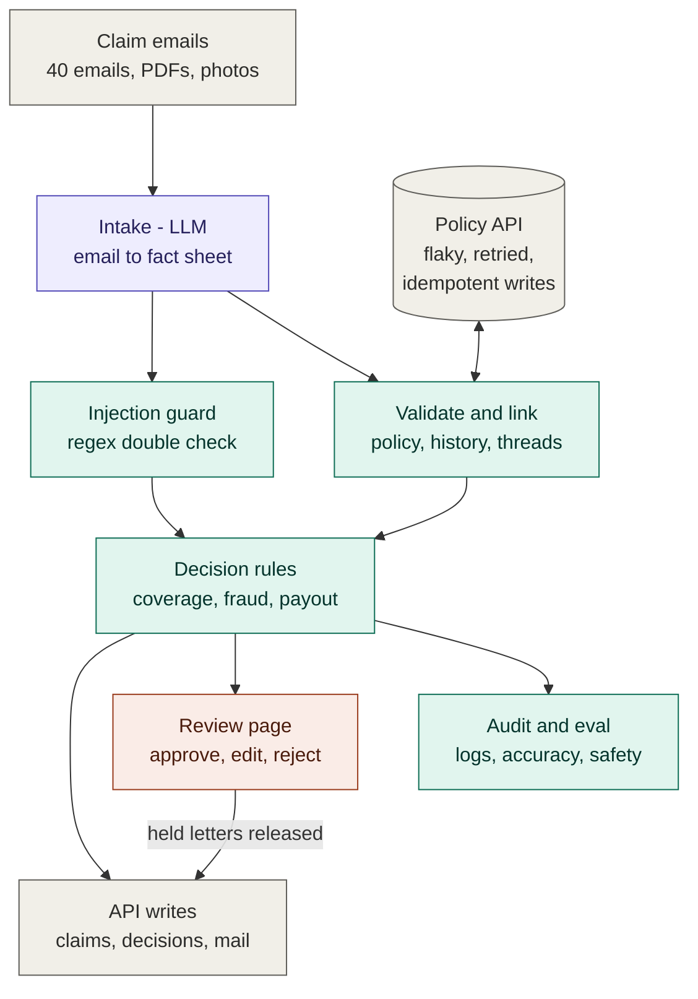

# Noorderhaven claims agent

An agentic claims-intake system for the fictional insurer Noorderhaven Verzekeringen, built in the 2-hour Gaide technical case. It reads claim emails (Dutch, English, mixed) with their PDFs and photos. It checks each claim against the policy API, looks for fraud signals, and decides what may be approved automatically and what goes to a human. It writes letters, offers a review page for handlers, and measures itself against a hand-made answer key.

**Core principle: the LLM extracts, code decides.** The LLM only turns an email into a structured fact sheet. Every coverage check, payout, routing decision and outgoing email is deterministic, testable Python. Email and document text is treated as untrusted data, so an injected instruction cannot approve anything.

See also: [DECISIONS.md](DECISIONS.md) (what was built, cut, assumed, faked), [PROMPTS.md](PROMPTS.md), [PROCESS.md](PROCESS.md) (how it was built), [docs/design.md](docs/design.md) (spec), [docs/plan.md](docs/plan.md) (build plan).

## Architecture



Purple is AI, green is plain code, orange is human, grey is data and outside systems.

### Flow per claim

1. **Intake** (`agent/extract.py`, `agent/pdf_text.py`, `agent/llm.py`, `agent/prompts.py`): PDF text is extracted with the standard library. A KIE.ai model (default `deepseek-v4-1-flash`, then `gpt-5-6-luna` and `gemini-3-7-flash` if it fails) returns strict JSON: intent, language, policy number, loss date, loss type, documents with amounts, and yes/no judgments (gradual damage, outside Europe, third party, other bank account, injection) each with an evidence quote. A deterministic regex for injection runs as well, and its result is OR-ed in. A schema check runs inside the retry loop, so a malformed answer counts as a failed attempt and the next model is tried; the last model is the stronger `claude-sonnet-5-5`. If no LLM can read the email (no key, all models fail), a keyword reader pre-fills the facts for a handler, but **nothing is decided automatically**.
2. **Validate and link** (`agent/pipeline.py`, `agent/threads.py`): replies are merged with the original email. The policy is looked up by number, or by sender email when the number is missing or wrong. Claim history comes from the API.
3. **Decide** (`agent/rules.py`): an ordered, pure function produces the action, net payout, a reason citing the rulebook section, flags, and a trace of every check.
4. **Write and communicate** (`agent/api_client.py`, `agent/comms.py`): claims, decisions and emails go to the mock API. Every write carries an `Idempotency-Key`. Retries handle 503 and 429 (honouring `Retry-After`) and timeouts. Letters are fixed NL/EN templates; rejections are held until a handler approves.
5. **Review** (`review/`): a local web page where a handler sees the email, extracted facts, rule trace and draft letter, then approves, edits or rejects. Every action is logged to `output/reviews.jsonl`.
6. **Monitor and evaluate** (`output/audit.jsonl`, `eval/run_eval.py`): a per-step audit trail, a run summary, and an eval against `eval/expected.json` with safety checks that must be zero.

## The seven parts

| Part | What it does here | Strength |
|---|---|---|
| 01 Intake | LLM + stdlib PDF text into a validated fact sheet; fallback extractor | strong |
| 02 Validation | policy active on loss date, peril covered, missing info, identity | strong |
| 03 Fraud signals | duplicates, 3+ claims/12 months, new policy, other IBAN, injection | strong for the listed rules |
| 04 Decision | payout maths, auto / handler / senior bands, reasons with rule refs | strong |
| 05 Communication | templated info requests, approvals, acknowledgements; held rejections; threads linked | medium |
| 06 Human review | local web queue with approve / edit / reject | medium–strong |
| 07 Monitoring | audit log, run summary, eval with safety checks | medium |

## Install and run

Requirements: Python 3.9+. **No packages to install** (standard library only).

```bash
# 1. LLM key (KIE.ai). Without it nothing is decided automatically: every claim goes to manual review.
echo "KIE_API_KEY=your-key" > .env
```

```bash
# 2. Start the mock API (chaos on, as in review). Keep it running.
python3 mock_api/server.py
```

```bash
# 3. In a second terminal: process all 40 claims. --reset clears the mock API state first.
python3 -m agent.run --reset
```

```bash
# 4. Evaluate against the answer key (accuracy, payouts, safety checks)
python3 eval/run_eval.py
```

```bash
# 5. Human review page at http://localhost:8000
python3 review/server.py
```

Other options:
- `python3 -m agent.run --no-llm` is a developer/test mode: the keyword fallback extractor makes decisions so the pipeline can be tested without a key. In normal mode, any claim not read by the LLM (no key, all models failed, extraction error) goes to manual review.
- `python3 -m agent.run --only C-001,C-005` processes a subset.
- Environment variables: `LLM_MODELS` (model chain, default `deepseek-v4-1-flash,gpt-5-6-luna,gemini-3-7-flash,claude-sonnet-5-5`; the stronger Sonnet is only paid for when the cheap models fail), `LLM_CONCURRENCY` (default 4), `CLAIMS_API_BASE` (default `http://localhost:8080`).

Tests (73 unit tests: rules, letters, API client retries and idempotency, PDF text, extraction, eval):

```bash
python3 -m unittest discover -s tests
```

## Outputs

| File | What |
|---|---|
| `output/decisions.json` | one entry per claim, in the case's hand-in format |
| `output/review_queue.json` | everything the review page shows: email, facts, policy, rule trace, letter |
| `output/audit.jsonl` | one line per pipeline step per claim, with API attempt counts |
| `output/run_summary.json` | counts per action, API and LLM stats, duration |
| `output/eval_report.md`, `output/eval_summary.json` | eval results |
| `output/reviews.jsonl` | handler actions from the review page (created on first review) |
| `output/metrics.json` | monitoring metrics and alerts (also live in the review page's Monitoring view) |
| `output/open_info_requests.json` | info requests: answered or open, days open, reminder due |
| `mock_api/runtime/` | the mock API's own record of every write and queued email, from the final run |

## Final run result

40 claims, chaos on, real LLM (`deepseek-v4-1-flash` via KIE):
- **Actions:** 9 auto-approved, 4 info requests, 11 escalated (8 handler, 3 senior), 7 rejections drafted (held), 6 fraud review, 3 routed elsewhere.
- **API:** 170 calls, 43 retries, 0 failed writes, no duplicates.
- **Eval:** 100% action and payout match, all safety checks 0. That number flatters it (see [DECISIONS.md](DECISIONS.md)), so there is also a **blind holdout** of 12 new claims written without seeing the code: **91.7% strict, 100% lenient, safety 0** (`eval/holdout/`).
- **Robustness** under heavy API failure, with KIE down, and on idempotent re-runs: [docs/robustness.md](docs/robustness.md).

## Repository map

```
agent/        pipeline: models, config, api_client, pdf_text, llm, prompts, extract, threads, rules, comms, pipeline, run
review/       review web page (server.py + index.html, sample_queue.json fixture)
eval/         expected.json (answer key, written before the code) and run_eval.py
tests/        unittest suite
docs/         design.md (spec), plan.md (build plan), kie-llm-api.md, case rulebook and API docs
claims/ mock_api/   the case's starter pack (unchanged)
output/       results of the final run
```
