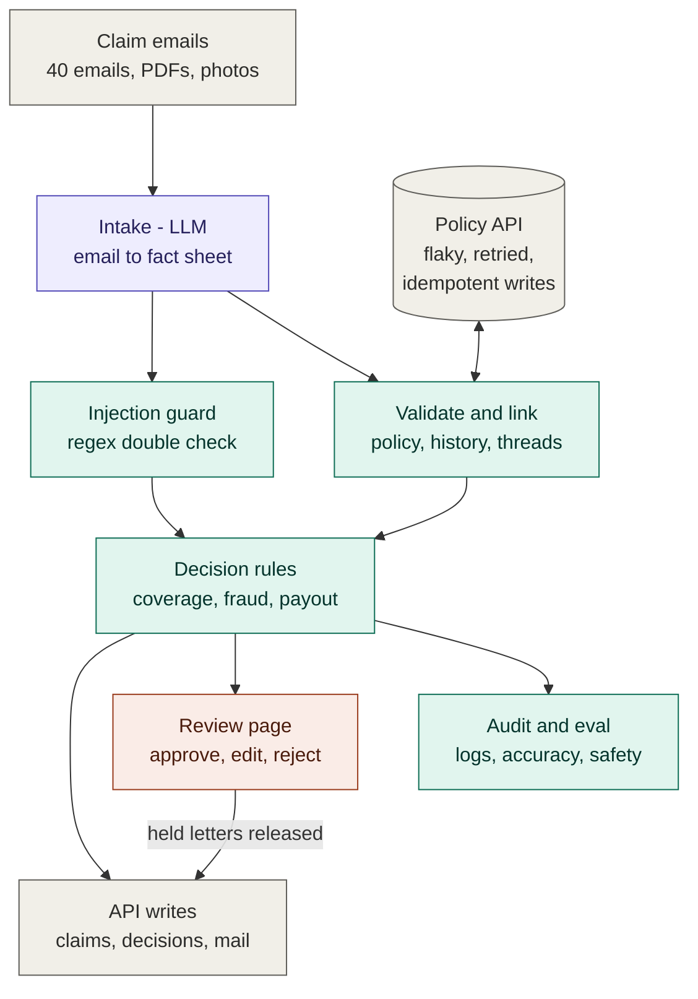

# Noorderhaven claims agent

An agentic claims-intake system for the fictional insurer Noorderhaven Verzekeringen, built in the 2-hour Gaide technical case. It reads claim emails (Dutch, English, mixed) with their PDFs and photos. It checks each claim against the policy API, looks for fraud signals, and decides what may be approved automatically and what goes to a human. It writes letters, offers a review page for handlers, and measures itself against a hand-made answer key.

**Core principle: the LLM extracts, code decides.** The LLM only turns an email into a structured fact sheet. Every coverage check, payout, routing decision and outgoing email is deterministic, testable Python. Email and document text is treated as untrusted data, so an injected instruction cannot approve anything.

See also: [DECISIONS.md](DECISIONS.md) (what was built, cut, assumed, faked), [PROMPTS.md](PROMPTS.md), [PROCESS.md](PROCESS.md) (how it was built), [docs/design.md](docs/design.md) (spec), [docs/plan.md](docs/plan.md) (build plan).

## Architecture

Purple is AI, green is plain code, orange is human, grey is data and outside systems.

### Flow per claim

1. **Intake** (`agent/extract.py`, `agent/pdf_text.py`, `agent/llm.py`, `agent/prompts.py`): PDF text is extracted with the standard library. A KIE.ai model (default `deepseek-v4-1-flash`, then `gpt-5-6-luna` and `gemini-3-7-flash` if it fails) returns strict JSON: intent, language, policy number, loss date, loss type, documents with amounts, and yes/no judgments (gradual damage, outside Europe, third party, other bank account, injection) each with an evidence quote. A deterministic regex for injection runs as well, and its result is OR-ed in. With no key, or if every model fails, a rules-based fallback extractor is used.
2. **Validate and link** (`agent/pipeline.py`, `agent/threads.py`): replies are merged with the original email. The policy is looked up by number, or by sender email when the number is missing or wrong. Claim history comes from the API.
3. **Decide** (`agent/rules.py`): an ordered, pure function produces the action, net payout, a reason citing the rulebook section, flags, and a trace of every check.
4. **Write and communicate** (`agent/api_client.py`, `agent/comms.py`): claims, decisions and emails go to the mock API. Every write carries an `Idempotency-Key`. Retries handle 503 and 429 (honouring `Retry-After`) and timeouts. Letters are fixed NL/EN templates; rejections are held until a handler approves.
5. **Review** (`review/`): a local web page where a handler sees the email, extracted facts, rule trace and draft letter, then approves, edits or rejects. Every action is logged to `output/reviews.jsonl`.
6. **Monitor and evaluate** (`output/audit.jsonl`, `eval/run_eval.py`): a per-step audit trail, a run summary, and an eval against `eval/expected.json` with safety checks that must be zero.

## The seven parts

| Part | What it does here | Strength |
|---|---|---|
| 01 Intake | LLM + stdlib PDF text into a validated fact sheet; fallback extractor | strong |
| 02 Validation | policy active on loss date, peril covered, missing info, identity | strong |
| 03 Fraud signals | duplicates, 3+ claims/12 months, new policy, other IBAN, injection | strong for the listed rules |
| 04 Decision | payout maths, auto / handler / senior bands, reasons with rule refs | strong |
| 05 Communication | templated info requests, approvals, acknowledgements; held rejections; threads linked | medium |
| 06 Human review | local web queue with approve / edit / reject | medium–strong |
| 07 Monitoring | audit log, run summary, eval with safety checks | medium |

## Install and run

Requirements: Python 3.9+. **No packages to install** (standard library only).

_(run instructions are finalised after integration)_
